# Reader-documentation review: published v0.3.5

**Result:** the maintained explanation is clean, organized and suitable for the declared reviewer, domain and engineering reading tasks on the inspected desktop surfaces. This is an agent editorial/rendered assessment, supported by actual source and publication checks. It is not an independent expert rating, controlled user study or full framework/accessibility certification.

Documentation **0.4.1** maintains published source **v0.3.5** and unchanged model **0.3.1**. The approved manuscript remains **7.0.8**. No next source-release version or submission-ready claim is inferred.

The owner requested that qualitative readability be assessed alongside machine checks. The criteria were fixed in [the review plan](../../../documentation/0.4.1/review-plan.json), adapted from the owner's OGCM-RF editorial/navigation/quality methods and the Portfolio public-content/onboarding methods. Their exact retrieved source commits and boundaries are recorded there. [Per-page dispositions and qualitative findings](editorial-review.json) cover all 21 guide sources.

## What changed and why

The original entry mixed release-process metadata with the research introduction and still described v0.3.5 as preparation. The Wiki sidebar was a flat list. The evaluation table mixed different evidence populations, and exact source/hash details crowded the primary reading.

The maintained view leads with the research subject and three audience paths. It separates the problem, method, evidence, limitations and reproduction tasks; groups Wiki navigation; and places detailed provenance below the explanation. All 25 clause bodies remain verbatim, inside anchored disclosures. Evidence limits remain in the primary narrative. The active repository README is concise; the source release's selected root README remains preserved as historical input. Download and version pages distinguish source release, semantic model and documentation identities.

No semantic source, original requirement, historical engine result, approved manuscript or source-release asset was changed. All 687 selected release inputs and four frozen documentation snapshots are preserved.

## Actual source and channel evidence

The initial readable publication is source `49e70f2042afd76081e65293f23070f88b216f0e`. Its full candidate passed **505 software tests** and **28 core checks**. An independently downloaded authenticated candidate matched all **1,143 source-file bodies and Git modes**. The new reader boundary suite passed ten tests, including rejection of altered source payloads, stale release status, changed live asset digests and broken fragments. The original25 detailed clause bodies were compared verbatim.

A fresh native Wiki clone at `7f75868592707d0a3395ef0ad68d25d50084482d` matched **all 23 files**. Separate hosted and root readbacks each verified **314 actual HTTP responses**, the exact root manifest and all four snapshots. The local site audit covers143 HTML pages and28,108 local links. These are engineering/publication checks, not scientific accuracy measures.

- [Independent candidate verification](initial-candidate-verification.json)
- [Independent actual channel readback](initial-independent-channel-readback.json)
- [Hosted actual channel readback](initial-hosted-channel-readback.json)
- [Native Wiki Git comparison](wiki-readback.json)

The final follow-up removes empty page-contents headings on short pages. It retains these 21 explanatory sources and23 Wiki bytes. The final exact source, CI/deployment and fresh postdeployment readback are recorded in [#60](https://github.com/ArazSaieArasi3/riskium/issues/60), so completion evidence does not require inserting a commit's own identity into its source.

## Rendered journey assessment

The captures below were taken during this run from the actual public surfaces, saved and inspected. Incorrect/intermediate captures were rejected. Observations concern the displayed task and environment; they do not certify untested devices or assistive technologies.

| Step | Reader task | Health |
| --- | --- | --- |
| 1 | Repository entry | Suitable for inspected task |
| 2 | Wiki entry and navigation | Suitable for inspected task |
| 3 | Pages entry | Suitable for inspected task |
| 4 | Problem and method | Suitable for inspected task |
| 5 | Results and evidence | Suitable for inspected task |
| 6 | Formal clause inspection | Suitable for inspected task |
| 7 | Limitations | Suitable for inspected task |
| 8 | Reproduction | Suitable for inspected task |
| 9 | Current versus frozen versions | Suitable for inspected task |
| 10 | Generated formal reference | Suitable for inspected task |
| 11 | Release downloads | Suitable for inspected task |
| 12 | Equivalent native Wiki clause | Suitable for inspected task |

### 1. Repository entry

The actual repository README identifies Riskium and published v0.3.5, then routes four reader tasks. The active README API selected the maintained landing file.

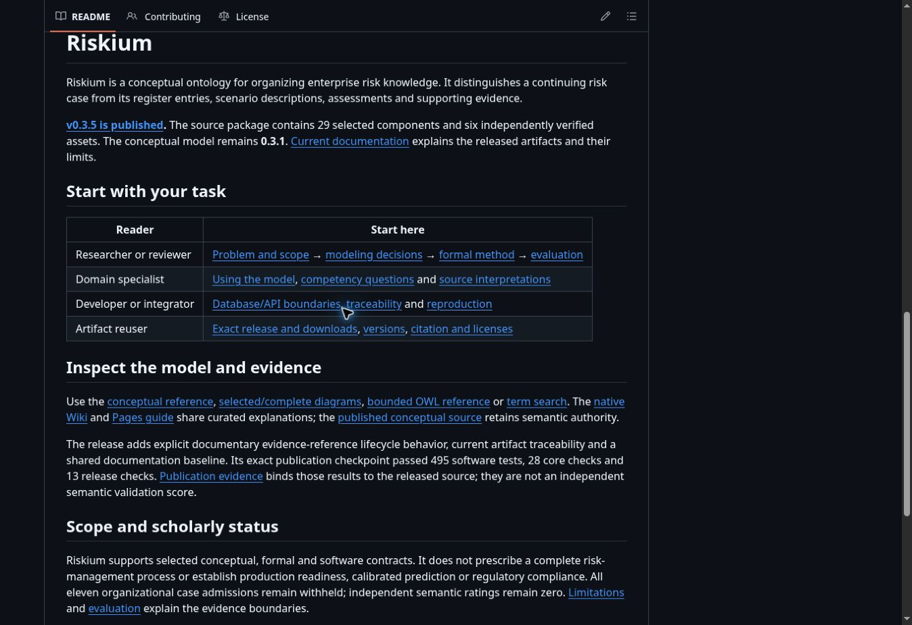

### 2. Wiki entry and navigation

The live Wiki has the same released state, three audience paths and grouped navigation; source/hash details no longer dominate the explanation.

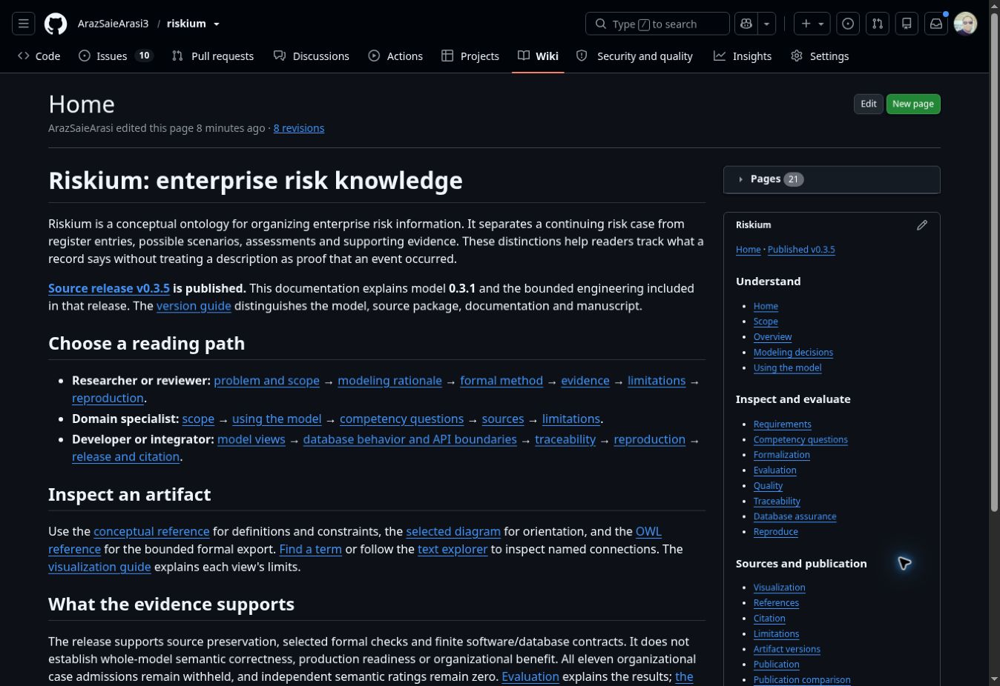

### 3. Pages entry

The published site shows documentation 0.4.1, model 0.3.1 and published source v0.3.5 with short paragraphs and ordered audience routes.

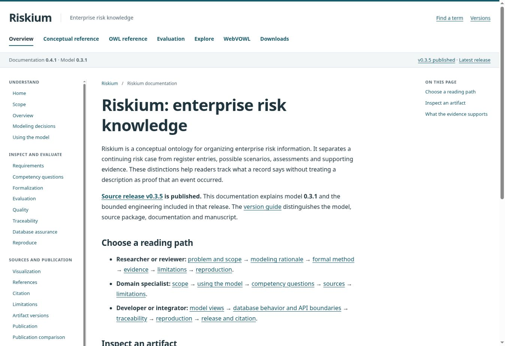

### 4. Problem and method

The reviewer route reaches a clear problem, bounded contribution and explanation of conceptual, formal, data and application evidence roles.

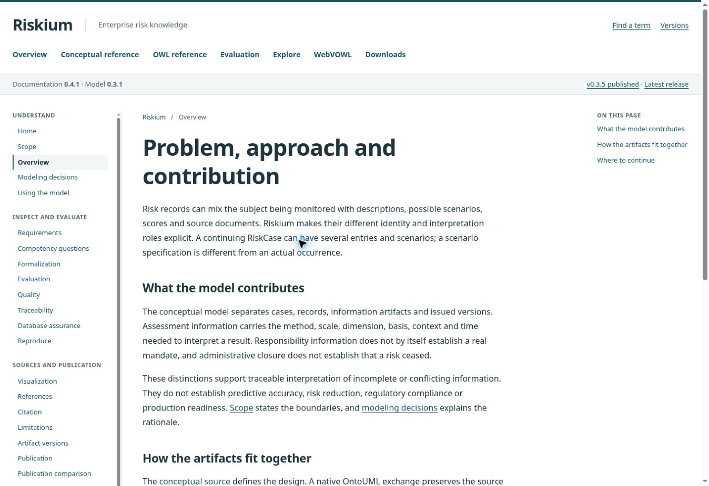

### 5. Results and evidence

Two short tables separate formal/data checks from source/software/trace evidence; unchanged partial/unexecuted and independent-review limits remain explicit.

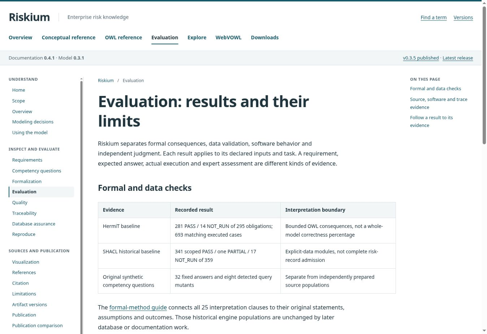

### 6. Formal clause inspection

The C-08 table link reaches its anchored disclosure. Enter opens it; the visible focus ring, original statement, historical PARTIAL and remaining obligations were inspected.

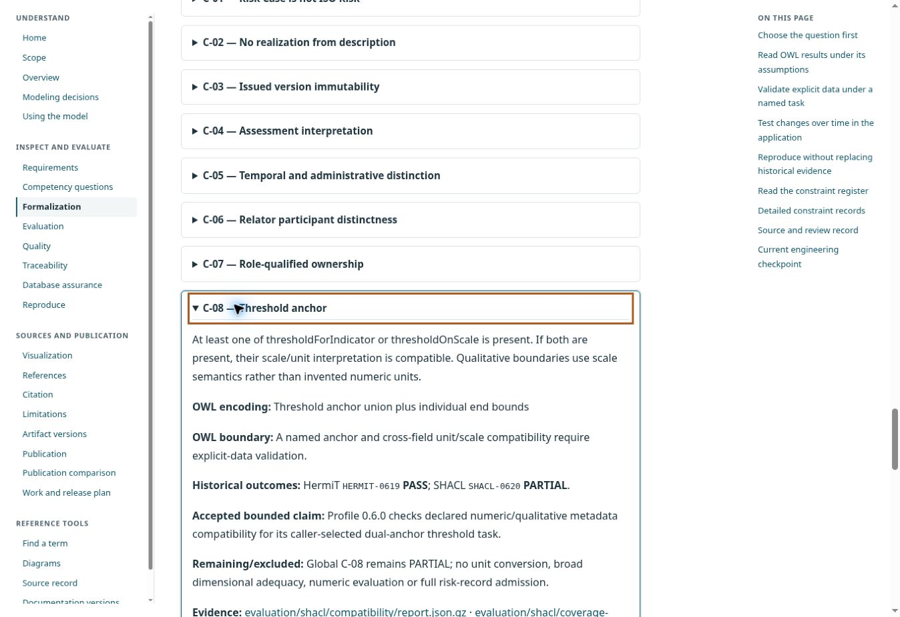

### 7. Limitations

The primary text exposes deferred mappings, bounded implementation and semantic/empirical limits instead of hiding them in provenance.

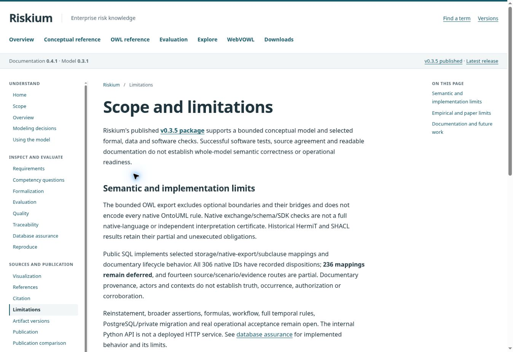

### 8. Reproduction

The reader reaches exact release, five payload checksums, commands, expected output and separate Git/private-file requirements.

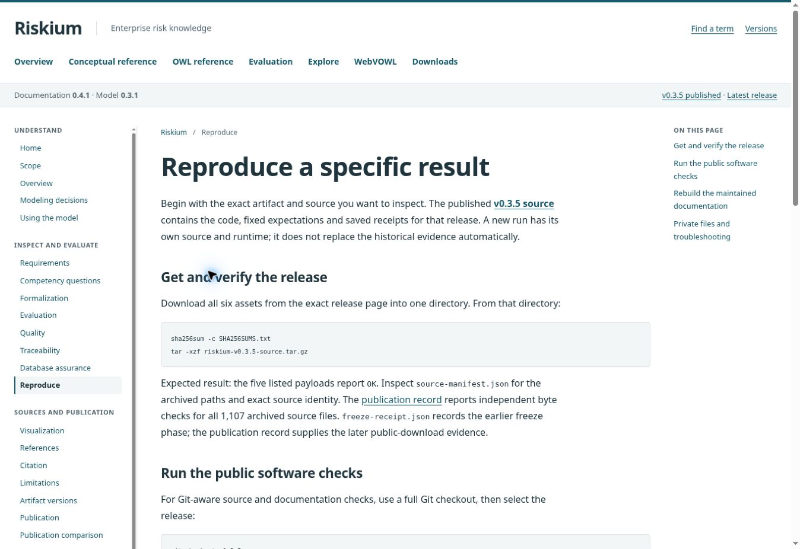

### 9. Current versus frozen versions

The version index explains the maintained view and all four immutable snapshots without presenting historical status as current Latest.

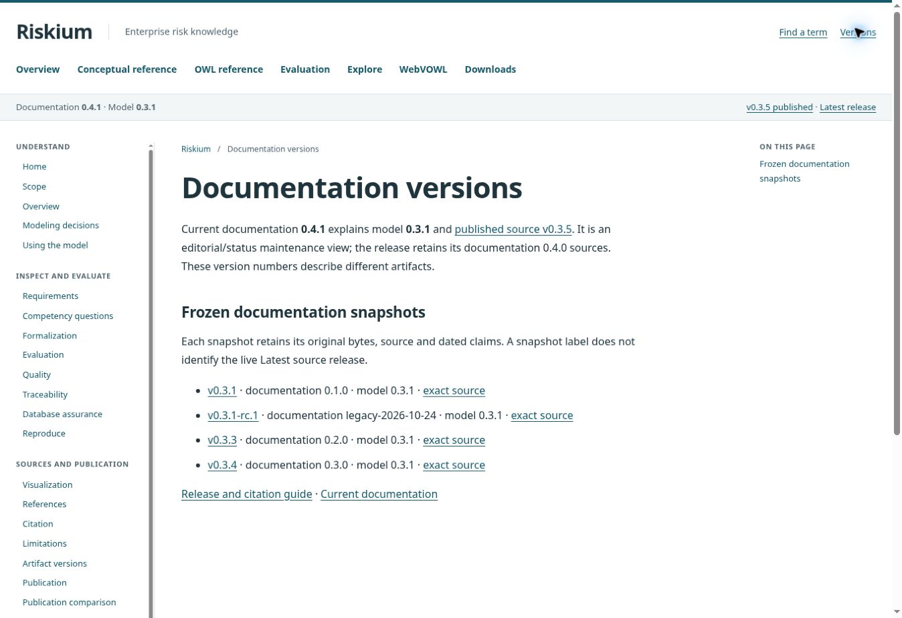

### 10. Generated formal reference

The generated reference remains linked to model 0.3.1, explains its bounded OWL meaning and retains source/exploration/download routes.

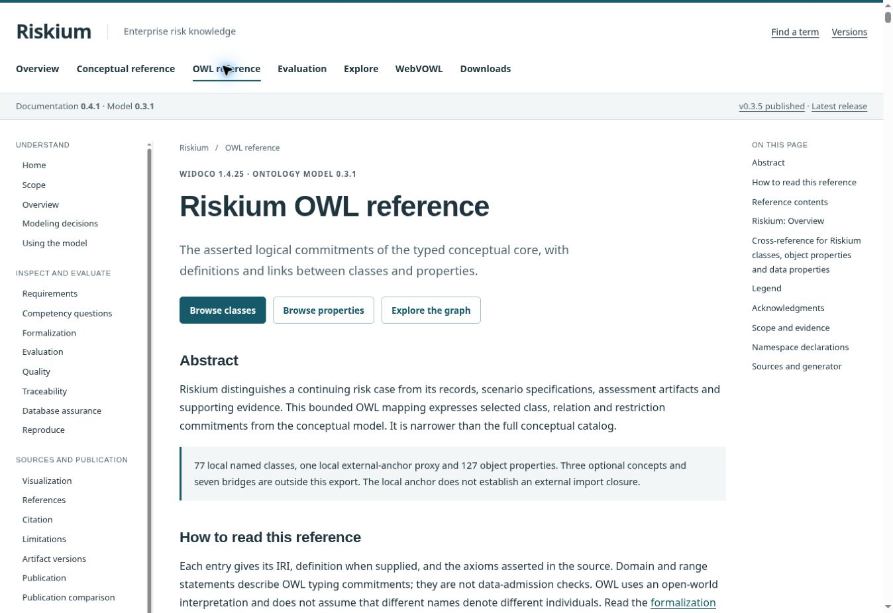

### 11. Release downloads

All six v0.3.5 asset links are together; website-subset files/checksums and historical model citation metadata have separate roles.

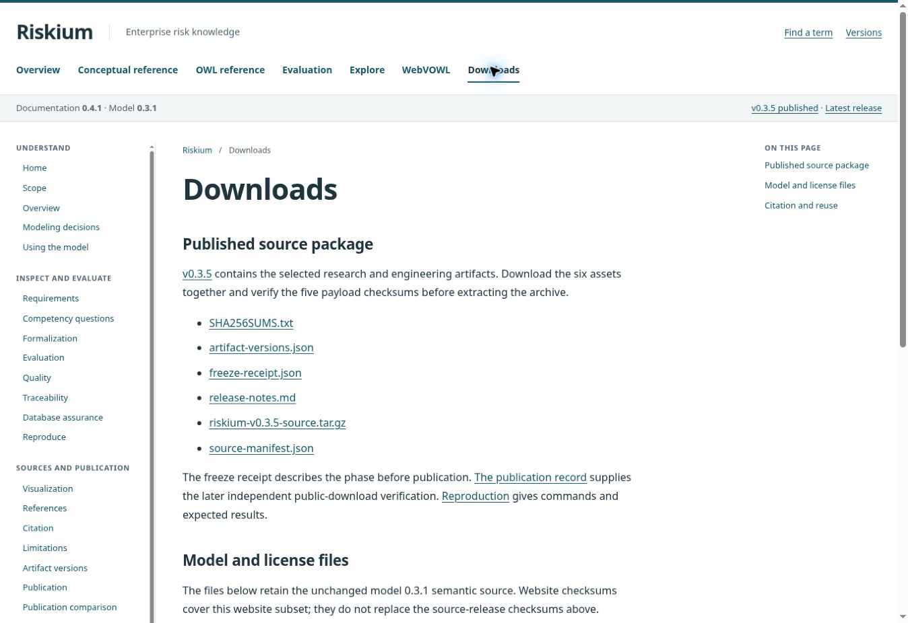

### 12. Equivalent native Wiki clause

The corresponding Wiki clause exposes the same statement/outcomes/limits. Enter was tested to collapse and reopen the disclosure.

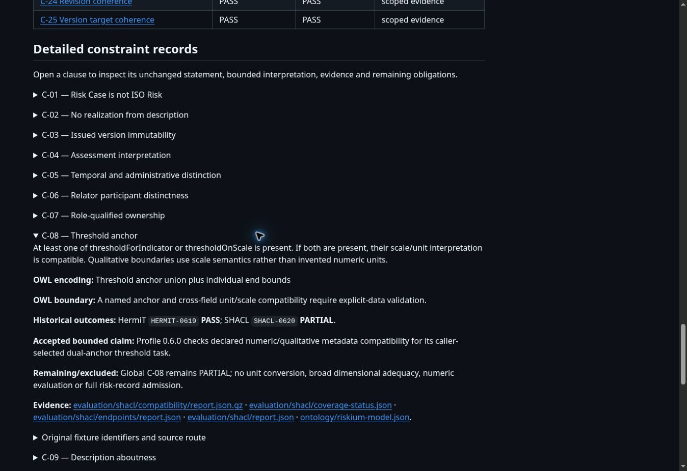

## Qualitative criteria

| Criterion | Finding |
| --- | --- |
| R01 — Orientation | Steps 1–4: subject and current released state precede process metadata. |
| R02 — Role journeys | Steps 1–4 and shared Home source: reviewer, domain and integrator paths exist without separate competing definitions. |
| R03 — Natural technical prose | All 21 guide sources reviewed; primary narrative has descriptive links rather than bare issue/stage labels. |
| R04 — Progressive disclosure | Steps 2–6 and12: exact provenance retained in disclosures; 25 clauses have named summaries and stable anchors. Empty page-contents headings on short pages are removed in the follow-up renderer. |
| R05 — Evidence fidelity | 10 focused boundary tests, unchanged 687 selected inputs, exact 25-clause body comparison and retained caveats/denominators; no new semantic acceptance claim. |
| R06 — Version intelligibility | Steps 1–3 and9: source 0.3.5/model 0.3.1/docs 0.4.1/paper 7.0.8 roles explained; next source version remains unset. |
| R07 — Source authority | Steps 9–11, canonical source destinations and four-snapshot byte checks; no semantic authority moved to the Wiki or Pages. |
| R08 — Reproduction usefulness | Step8: prerequisites/commands/expected results/Git and private boundaries checked against the actual source/release receipts; no new private or full engine rerun claimed. |
| R09 — Visual and keyboard reading | Steps 1–12 inspected in the actual desktop browser; C-08 disclosures toggled with Enter on Wiki and Pages; visible Pages focus ring confirmed. |
| R10 — Cross-surface consistency | Actual active README API/rendered body, fresh23-file Wiki clone and314 independent served HTTP responses at the initial published documentation source agree. |

The scoped verdict reflects editorial judgment from these observations. A machine count cannot substitute for semantic expert review, and a clean interface does not establish scientific adequacy. Actual independent semantic ratings remain zero; all eleven organizational admissions remain withheld. No full WCAG certification, real-mobile test or comparative user-study result is claimed.

## Captured before-state

The initial Wiki entry exposed multiple artifact/process versions and a flat sidebar. Both entry surfaces showed the obsolete v0.3.4/latest and v0.3.5/preparation state. The old evaluation page used one dense table and had an empty contents rail.

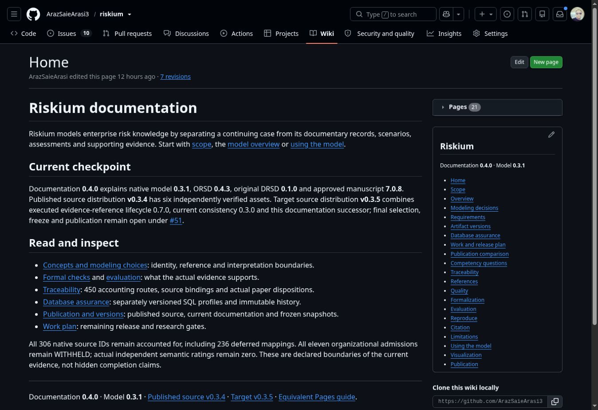

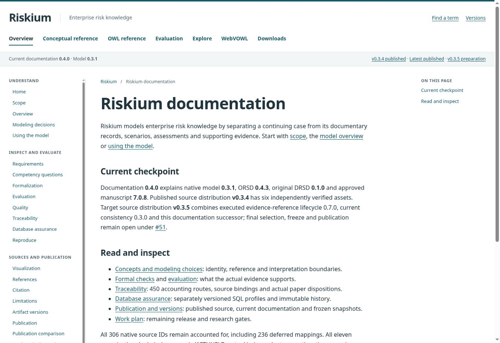

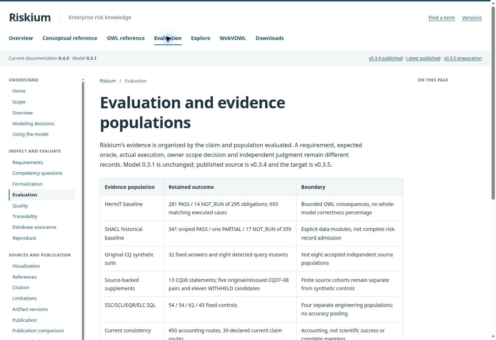
