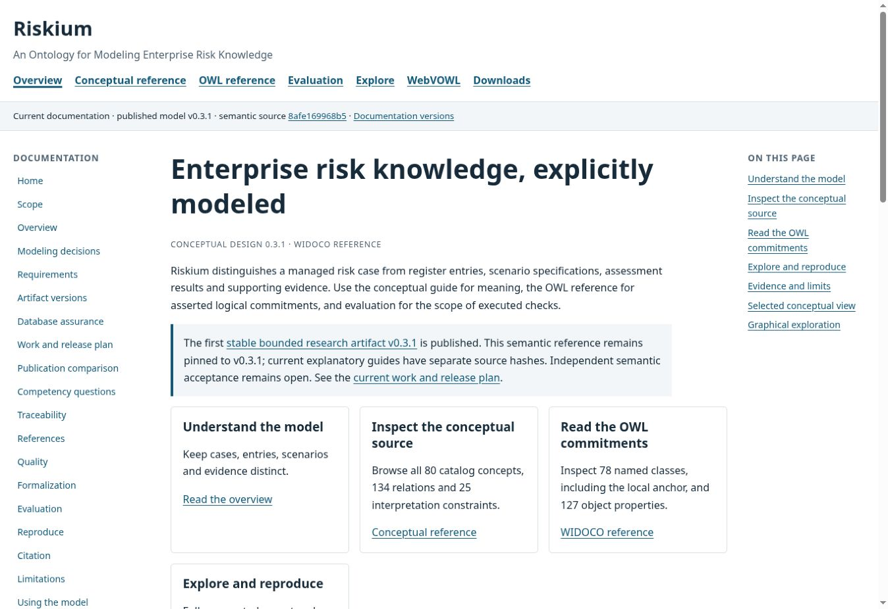
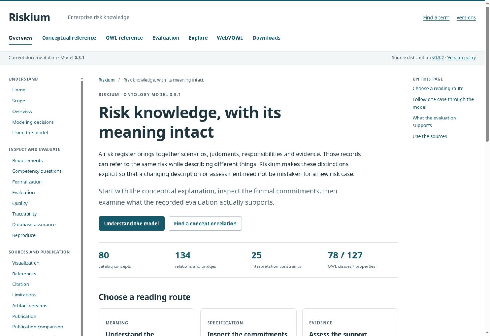
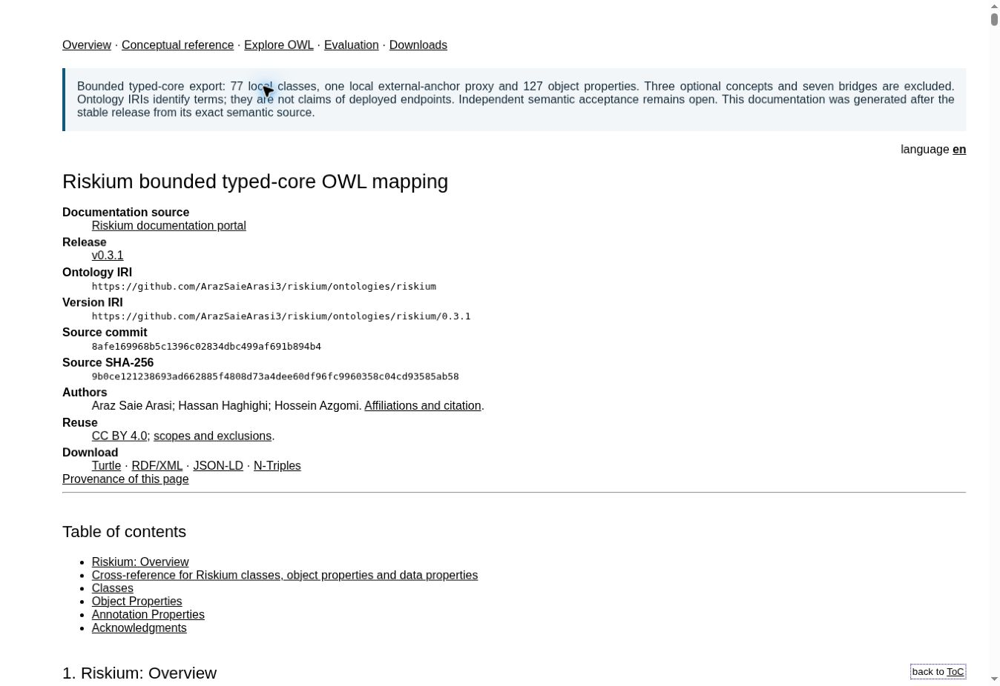
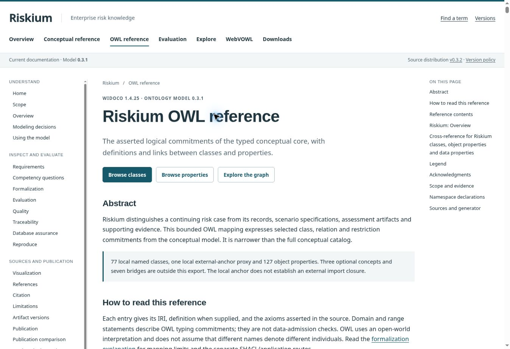
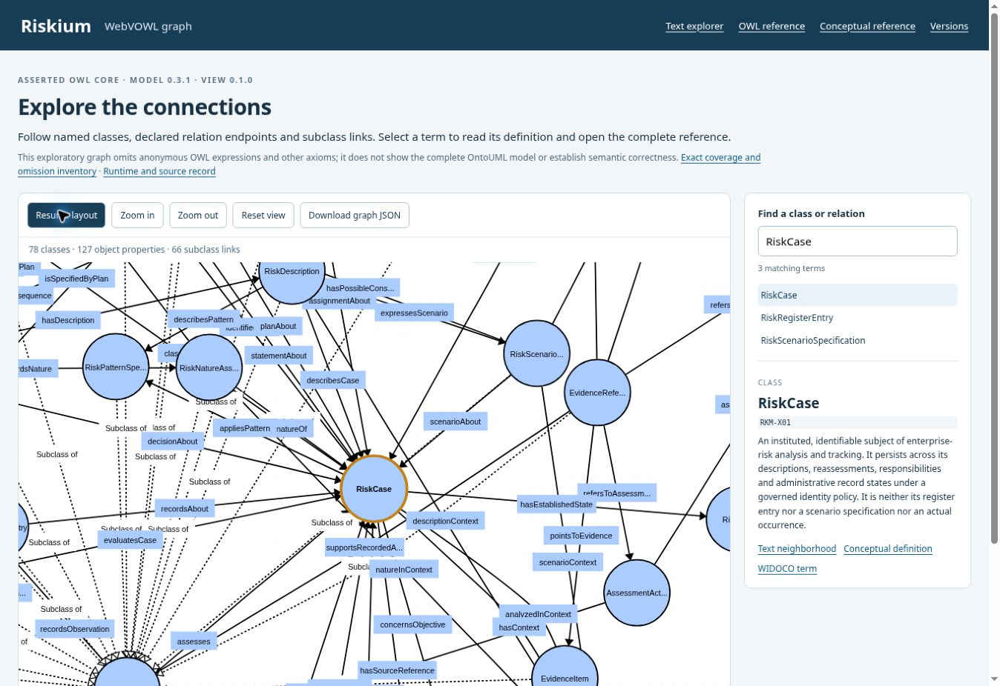
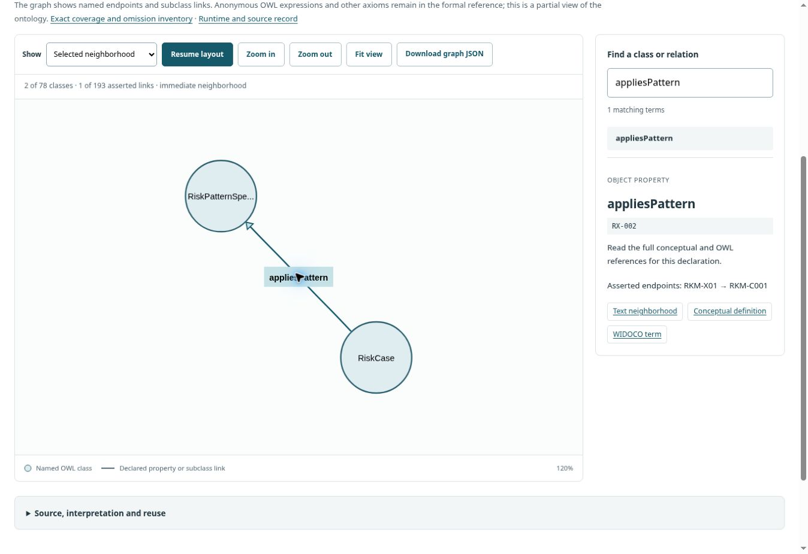

# Riskium Pages: design, content and navigation review

The current Pages upgrade is complete for [issue #38](https://github.com/ArazSaieArasi3/riskium/issues/38). The issue contains the expanded implementation brief, full checklist and assessment protocol requested by the owner. The maintained site is [Riskium Pages](https://arazsaiearasi3.github.io/riskium/current/index.html?source=bfcdc287b2d7).

Baseline: `eb0ff1d64e87c8667aa9f3eab46d700ffc61a7ee`. Final tested and deployed implementation: **`bfcdc287b2d74341dee4e366771ec04af1a0127b`**. Later evidence-only commits record this result; they do not claim a different tested implementation.

## What changed and why

The main problem was fragmentation. The home/guide template, WIDOCO output, WebVOWL shell and version/provenance pages did not provide the same reading experience. The WIDOCO page began with dense source metadata; WebVOWL presented a crowded full graph in a different visual language. Some current guides still described the deployed viewer as future work and the already published successor distribution as planned.

All **31 current reader routes, including the version index**, now use one shell: typography, palette, spacing, primary navigation, grouped guide navigation, breadcrumbs, mobile contents, focus styles and footer. Explanation, reference, graph and provenance bodies retain structures appropriate to their tasks. Two registered historical documentation snapshots retain their exact original bytes and layouts.

The landing narrative explains the risk-knowledge problem and reading routes before provenance. Nine guide sources were edited for clarity and verified status/version corrections. All 21 shared guides have recorded editorial dispositions. Historical evidence pages keep their dated populations and checkpoint context. The accepted ORSD source, priorities and criteria were not edited; its subsequent publication is explained as separate context.

WIDOCO 1.4.25 genuinely regenerates the reference. Its **215 generated term entries and axiom text are unchanged**. The common shell adds an abstract, reading instructions, OWL interpretation boundaries, search, term cross-links, namespace declarations, source details and downloads. Original resources, LODE/WIDOCO credits and licenses remain available. The original Turtle is byte-preserved; four serializations remain graph-isomorphic.

WebVOWL starts with a small neighborhood rather than the complete graph. A class selection shows its immediate asserted connections; a property selection shows its actual endpoints. The complete projection remains available. Layout settles then pauses; search, selection, fit, zoom and pause/resume work. Default, selected and hover colors follow the same site palette. Shared CSS and graph entry links carry content identities to prevent stale presentation assets.

The term directory covers 240 concepts, relations, constraints and the local anchor, linking only to applicable views. The diagram directory distinguishes selected and complete conceptual SVGs and opens their original files for zooming. The maintained model is 0.3.1; the latest source distribution is v0.3.2. Those identities are now explained consistently.

## Assessment: 6/20 before, 15/20 after

This is an **assistant-assisted interface and editorial audit**, using the rubric declared in #38 before implementation. It is not an independent user study or a measured percentage of comprehension, satisfaction or ontology correctness. Each dimension is scored 0–4: absent/broken; fragmented with major friction; usable with material friction; coherent and tested with minor limits; coherent with independent reader confirmation. No dimension receives 4 without that confirmation.

| Dimension | Before | After | Evidence for the change |
| --- | ---: | ---: | --- |
| Visual consistency | 1 | 3 | Common primary navigation on 25/29 baseline routes; the shared contract now covers 31/31 current routes. WIDOCO, graph, versions and provenance use the same design. |
| Navigation and findability | 2 | 3 | Grouped guide routes, narrow-screen contents, breadcrumbs, term lookup and selected/complete diagram entry points. Actual constraint and cross-reference navigation succeeded. |
| Reference usability | 1 | 3 | Readable introduction, source disclosure, WIDOCO filtering and conceptual/OWL links; all 215 generated entries preserved. |
| Graph usability | 1 | 3 | Default view: five classes/six links; property focus: two classes/one link; complete projection: 78 classes/193 links. Actual controls and narrow-screen selections succeeded. |
| Editorial and version clarity | 1 | 3 | Nine edited sources, corrected deployed-viewer status and source-distribution/model distinction; historical evidence and material limitations retained. |
| **Total** | **6** | **15** | **Nine rubric points gained within this reviewed scope.** |

The before/after inventories and scoring are in [baseline](baseline.json), [current routes](current-inventory.json), [assessment](assessment.json) and [editorial dispositions](editorial-review.json).

## Browser steps and outcome

These observations concern the actual deployed site, not merely generated HTML or screenshots from OntoSPK.

| Step | Reader task | Outcome and health |
| --- | --- | --- |
| 1 | Understand the entry page | Good: problem, model distinctions, reading routes and version identity are visible before dense provenance. |
| 2 | Read a guide | Good: grouped navigation, readable measure, current-page indication and source disclosure; existing scientific meaning retained. |
| 3 | Find a term or constraint | Good: C-08 lookup and its conceptual-reference link succeeded. Full-text search also returns related entries; exact-match ranking is not provided. |
| 4 | Inspect the conceptual reference | Good: the original constraint text and identifiers remain intact; the selected anchor is visible in the common shell. |
| 5 | Inspect WIDOCO declarations | Good: RiskCase/appliesPattern filtering, source anchors and conceptual links worked. No generated axiom text was lost. |
| 6 | Inspect the asserted graph | Good with limits: neighborhood/full views, pause/resume, zoom/fit and term selection worked. Complete graphs remain dense and some long labels are abbreviated. |
| 7 | Open conceptual diagrams | Good with limits: both original SVGs loaded and opened. The overview thumbnails are inspection entry points; the original SVG is needed to read dense labels. |
| 8 | Identify versions and read on narrow screens | Good: model/distribution/frozen-documentation distinctions are explicit; all 16 tested iframe views had no horizontal overflow. |

Keyboard Tab reached the skip link and Enter focused `main#content`. Narrow-screen contents expanded. At 390 pixels, RiskCase selected 22 classes/40 asserted links; at 760 pixels, appliesPattern selected its two classes/one link. Final actual complete SVG ID sets matched all 78 source classes and all 193 projected property/subclass IDs. No site-origin console errors were observed; unrelated browser-extension metadata errors were excluded explicitly.

The first browser pass found two real overflow defects: WIDOCO reached 605 pixels in a 375-pixel content viewport; a long camel-case name made the text explorer reach 377 pixels. Wrapping and WIDOCO container/font styles corrected these. The final 390/760 iframe checks passed for overview, conceptual reference, WIDOCO, text explorer, WebVOWL, term search, guide and versions. These are actual CSS-pixel iframe viewports, not physical-device or screen-reader tests.

See [raw browser observations](browser-readback.json) and [ID/overflow verification](browser-verification.json).

## Reproducibility and publication checks

- **213 software regressions passed**, 98.168 seconds in the final local run: [log](software-regression.log).
- **25 hosted candidate checks passed** on the exact implementation: [candidate CI](https://github.com/ArazSaieArasi3/riskium/actions/runs/40207631070).
- [Documentation integrity](https://github.com/ArazSaieArasi3/riskium/actions/runs/40207631058), [Pages deployment](https://github.com/ArazSaieArasi3/riskium/actions/runs/40207682189) and [post-release integration/scope](https://github.com/ArazSaieArasi3/riskium/actions/runs/40207631054) succeeded. [Normalized readback](ci-readback.json) records the candidate's actual 25-check/inventory summary and no source-release publication.
- The assembled site contains 177 files and 83 HTML documents. All **14,546 local links/fragments** passed; the two frozen snapshots retained their registered hashes.
- The root deployment manifest identified the exact implementation. **175 actual public HTTPS file bodies** matched their hashes, including all model/RDF/viewer downloads and frozen files. The empty `.nojekyll` build marker was excluded: [HTTP readback](http-readback.json).
- Core text/background contrast pairs range from **5.59:1 to 12.95:1**. This is a measured palette check, not full accessibility conformance.

Reproduce the presentation checks from the repository root:

```sh
python tools/build_reference.py --check
python tools/publication/audit_portal.py
python tools/publication/build_versioned_site.py --check
python tools/publication/build_wiki.py --check
python -m unittest discover -s tests -p test_pages_presentation.py -v
python -m unittest discover -s tests -p test_webvowl.py -v
```

Use the pinned documentation requirements. To regenerate WIDOCO, follow `tools/publication/README.md` and verify the pinned 1.4.25 jar before running the postprocessor. Changing shared shell/navigation/style sources requires regenerating both the portal and WIDOCO before the audits.

## Before and after screenshots

All images are the exact browser JPEG bytes captured and visually inspected in this audit. [The image inventory](screenshot-inventory.json) records their hashes. Baseline screenshots are from the declared baseline; final screenshots are from the final published implementation. The OntoSPK image is comparison context, not Riskium execution evidence.

| Surface | Before | After |
| --- | --- | --- |
| Home |  |  |
| WIDOCO |  |  |
| WebVOWL |  |  |

[OntoSPK comparison](screenshots/04-reference-ontospk.jpg) · [Formal term](screenshots/07-after-owl-term.jpg) · [Responsive versions](screenshots/09-responsive-versions.jpg) · [Term search](screenshots/10-search.jpg) · [Conceptual constraint](screenshots/11-native-constraint.jpg) · [Diagram directory](screenshots/12-diagrams.jpg) · [Guide reading](screenshots/13-guide.jpg).

## Editorial basis and remaining limits

The private OGCM-RF editorial-integrity standard and the portfolio's academic-writing, research-quality and cross-chapter-coherence guidance were read. Applied principles: domain explanation before workflow history; claim–evidence discipline; stable terminology; page-purpose-specific bodies; progressive provenance disclosure; precise limitations; and verified status corrections. Their private text/data was not copied into the public repository. No detector optimization, fabricated authorship or independent expert endorsement is claimed.

Equivalent Markdown for all 21 Wiki guides is synchronized in the repository. This package does not claim a new live Wiki write/readback. The source model, generated OWL, original engine populations and fixed WebVOWL projection/omission inventory remain byte-preserved: [source checks](source-preservation.json). The graphical projection still represents 808 of 2,087 RDF statements; 1,279 are outside it. A neighborhood is a further visible subset.

Independent reader feedback, physical devices and assistive-technology behavior remain untested. A complete graph remains visually dense; long labels use the full inspector/reference for reading. Full-text search includes related matches. Original diagrams are preserved rather than relaid out. Those limits explain why the rubric stops at 3 per dimension.

Broader formal-method explanation and all-25-constraint evidence routes remain [#33](https://github.com/ArazSaieArasi3/riskium/issues/33). Source/SQL, remaining formal/application rules, legitimate normative/prior-art interpretation, independent reviewers and deployment acceptance remain in their existing issues. Historical HermiT 14 NOT_RUN, SHACL 17 NOT_RUN/one PARTIAL, zero independent-review responses and eleven WITHHELD organizational candidates remain unchanged. A better website does not close these scientific obligations.
