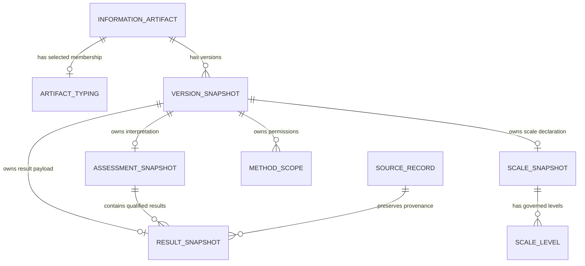

# Selected relational ownership structure

This database ERD explains the six added tables and their identity/version owners. Exact columns, keys, optionality and all base relationships remain authoritative in [the actual schema dictionary](schema-dictionary.md) and DDL. The diagram is not an OntoUML ontology diagram or proof of domain correctness.

Artifact identity is stable across versions. Metadata is staged before issue and frozen with its owner. Direct references and version targets are checked separately; absence of an explicit direct assertion is preserved. Multiple qualified values use distinct result identities/versions, with a stable parent assessment identity. A new assessment version does not rewrite earlier native interpretation graphs or historical SQL answers.
