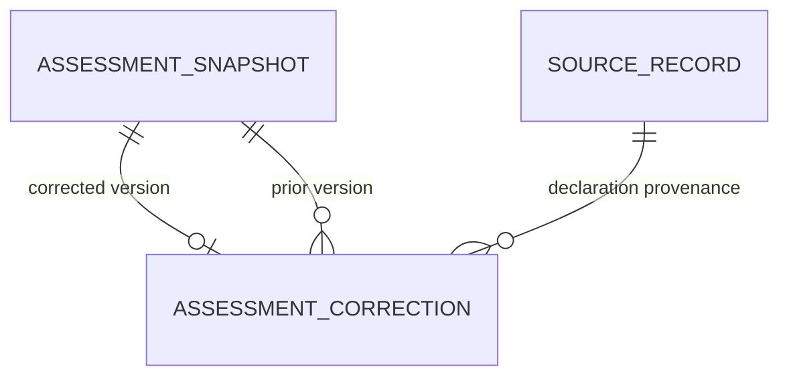

# Public assessment correction overlay 0.3.0

This bounded child of #35/#12 adds migration 4 and an immutable application correction record for issued assessment versions of the same identity. The [requirements/policy](contract.json) and [fixed answer oracles](fixtures.json) were declared before implementation at `753dccdce0865c6cbd3400aa245cea1b2e26d0d6`. A documented COR-04 source-ID citation correction changes no oracle or acceptance meaning.

The [SQL](004_correction.sql), [dictionary](schema-dictionary.md), [bound family query](queries/family.sql), [descendant query](queries/descendants.sql), [source/requirement accounting](../../../evaluation/relational/correction/traceability.json) and [execution receipt](../../../evaluation/relational/correction/README.md) identify the scope. [The component manifest](component.json) pins evaluated inputs, outputs and tests independently of the published v0.3.2 distribution and earlier development overlay 0.2.0.



The two assessment references must identify issued versions of one assessment artifact. A corrected version has one predecessor; a predecessor may have multiple corrected branches. The query returns all declared branches and their original lexical values, UNKNOWN and source qualifiers. It never selects a latest/authoritative branch or counts corrections as independent corroboration. Declaration timestamps are separate from the recorded assessment and result payloads.

`relational_correction.migrate(connection)` accepts a verified populated v3 database or validates an existing v4 database. Unsupported earlier schemas must use the original reviewed migration path first. `connect(path)` is the v4 reader. The old assessment v3 reader intentionally rejects v4. `issue_corrected(...)` validates, issues the assessment/results and records the correction in one transaction; any failure rolls back identities, sealed values and the edge. No draft data are returned as issued correction history. Call `health()` before directly executing either example query.

```sh
python tools/run_relational_correction.py --check
python tools/build_correction_inventory.py --check
python -m unittest discover -s tests -p test_relational_correction.py -v
```

Use the repository's pinned SHACL/RDF dependencies for the RDF differential receipt. Existing 0.1.0/0.2.0 schema and scientific receipts remain unchanged. No native revisionOf, derivedFrom or new OWL property is asserted by the correction record. General assertion correction, source/scenario mapping, actual occurrence/identity/source adequacy, workflows, formulas, intervals, PostgreSQL/private migration and independent review remain outside this packet. All eleven organizational admissions remain WITHHELD. This is reviewed synthetic development, not a new stable release or production certification.
