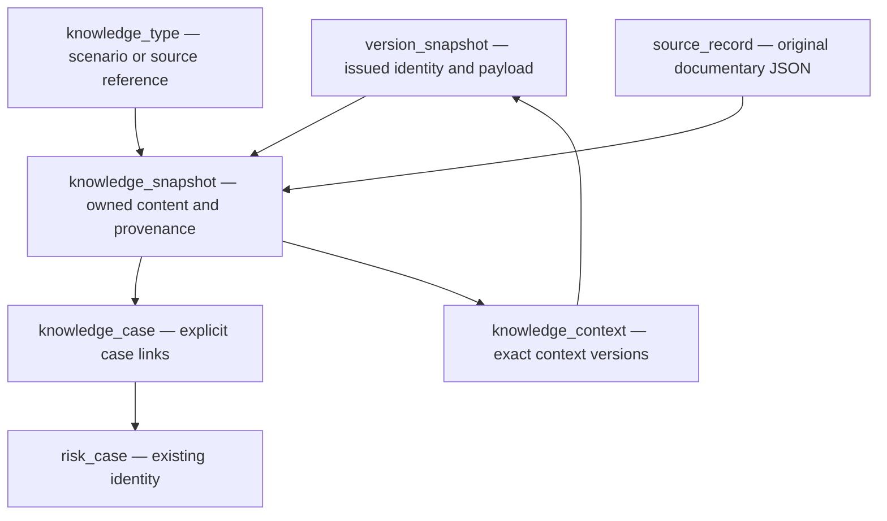

# Source/scenario storage dictionary — 0.4.0 / migration 5

| Table | Identity and columns | Ownership and constraints |
| --- | --- | --- |
| knowledge_type | artifact_id PK/FK information_artifact; native_class | Only RKM-C003 or RKM-X06, with existing generic RKM-C014 backing. Cannot overlap assessment artifact_typing. Immutable. |
| knowledge_snapshot | version_id PK/FK version_snapshot; artifact_id FK knowledge_type; narrative; source_record_id FK source_record; source_locator; interpretation_origin; recorded_at | Exact version owner/documentary source; nonempty text, canonical real UTC calendar time, payload equality. Immutable normalized content; native graph only after seal. |
| knowledge_case | (version_id,case_id) PK; FKs knowledge_snapshot and risk_case | Explicit case identity only. Scenario requires ≥1 at seal; source reference allows zero or many. Native direction depends on the declared class. No case is created by admission. |
| knowledge_context | (version_id,context_id) PK; UNIQUE(version_id,context_version_id); FKs knowledge_snapshot, information_artifact, version_snapshot | Exact issued RKM-C002 context version/owner. Scenario permits zero or many distinct contexts; source reference permits zero or one. No changes or additions after issuance. |

All new rows reject UPDATE/DELETE; replacing an existing key is separately rejected. Issuance is atomic through the configured API. A failed insertion or seal rolls back artifact/version/type/link additions. Read APIs fail closed on schema, ledger or semantic drift. Unissued managed staging is never exported as a native scenario/source-reference graph; incomplete raw content belongs in source_record.

The graph describes storage dependencies. It does not assert a native direct source-reference→scenario association. Shared case identity is a retrieval join, not a causal or evidential statement.

## Supplementary fields

recorded_at is application recording/issuance metadata, not event time. narrative, source_locator and interpretation_origin preserve the declared fixture content and source trace; they are not new native datatype properties or native EvidenceReference admission. Pinned context versions retain their native versionOf identity but their particular selection policy is application-owned.

## Index rationale

knowledge_case_lookup(case_id,version_id) serves the declared by-case query without joining on equal labels. knowledge_history(artifact_id,version_id) keeps version lookup separate from labels/time ordering. knowledge_provenance(source_record_id,version_id) serves source-qualified retrieval, while knowledge_context_version(context_version_id) identifies pinned dependencies. Primary/unique keys reject duplicate owner bindings. These are design rationales for this bounded workload; no production throughput or latency claim is made.
