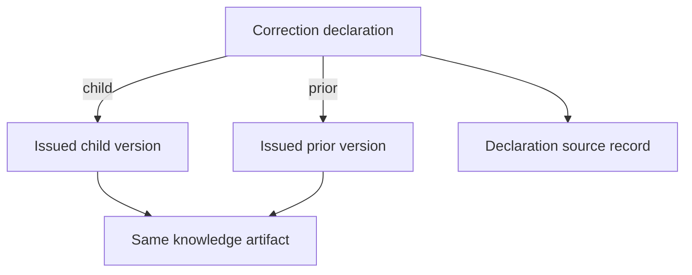

# SQLite migration 6 dictionary and design review

One new **STRICT** table supplements the unchanged v1–v5 schema. Prior definitions, functional dependencies, column meanings and native exports are retained. This review concerns the additional seven columns, not a new acceptance of the complete database or native ontology.

| knowledge_correction column | Key / domain | Meaning and ownership |
| --- | --- | --- |
| corrected_version_id | Text PK, FK knowledge_snapshot.version_id | Exact issued child; its identity determines the single declaration row |
| prior_version_id | Required text FK knowledge_snapshot.version_id | Exact issued prior of the same artifact/class; may have several distinct children |
| reason | Required nonblank text | Curator's declared correction reason; no truth or authority judgment |
| recorded_at | Required canonical UTC seconds, real calendar | Declaration time, at or after both endpoints' recorded/issued times; no latest-wins policy |
| source_record_id | Required FK source_record.record_id | Documentary source of the declaration, independently retained from endpoint sources |
| source_locator | Required nonblank text | Locator within that declaration source |
| interpretation_origin | Required nonblank text | Origin of the declaration interpretation; no independent-corroboration inference |

The sole nontrivial table functional dependency is **corrected_version_id → all other columns**. Neither source nor time determines a version or an authoritative value. The row models one declaration per child, so no separate synthetic declaration ID is required. Scenario/source class is derived through the issued snapshot's artifact and knowledge_type; it is not redundantly stored. Case/context/narrative/version source remain in their original version-owned tables. The correction source is an independent assertion and cannot be inferred from an endpoint source. No encoded payload hides a correction edge.

The PK already supports child/parent traversal and declaration lookup by child. `knowledge_correction_parent` supports reverse traversal for all descendants; `knowledge_correction_source` supports source attribution lookup/FK checking. No redundant index on corrected_version_id is added. These are query-design rationales, not measured production workload/SLO acceptance.

Insertion guards reject replacement/second parent, self/cycles, missing/unissued/nonknowledge endpoints, cross-artifact/class pairs, missing source, empty provenance and invalid/early declaration time. UPDATE/DELETE always fail. The independent invalid-data view and reader audits repeat semantic checks after restore, including cycles. Existing version immutability guards still protect endpoint payload, cases, context pins and source. No earlier table, view or trigger is replaced by migration 6.

`family.sql` uses a parameterized recursive UNION (deduplicated exact IDs) rooted at one issued version. Output rows preserve endpoint and declaration provenance separately, sorted cases/context pins and all explicit descendant branches. A subtree can expose a root's prior metadata without including that ancestor as a result row. Empty context remains an empty list. Source JSON is returned exactly as stored. Native RDF uses the unchanged per-version v5 view; correction metadata has no native export.

A populated v5 database must pass the v5 reader before migration. The v6 reader checks six migration hashes, user_version, exact schema/configuration, integrity/FKs, all prior data audits and new correction data. It accepts its own version on repeat; older exact-schema readers reject it. Backup/reopen, file reopen, dump restoration and failed-upgrade rollback execute against actual SQLite. Administrative bypass that creates an otherwise valid new database is outside this assurance boundary.
