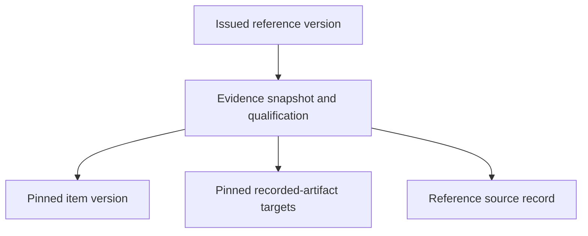

# Migration 7 dictionary and design review

Three new STRICT tables supplement unchanged v1–v6 storage. No previous table, view or trigger is replaced. This is a review of the additional columns and selected mapping, not full database/domain acceptance.

| Table / column | Key and meaning |
| --- | --- |
| evidence_reference_type.artifact_id | PK/FK information_artifact; C065 uses the same documentary C014 identity. This profile requires generic C014 storage separate from assessment/knowledge typing; it is not native disjointness. |
| evidence_snapshot.version_id | PK/FK version_snapshot; exact owning reference version |
| evidence_snapshot.artifact_id | FK evidence_reference_type; owner agrees with the base version |
| evidence_snapshot.item_id | FK information_artifact; existing evidential bearer, derived from the exact item version |
| evidence_snapshot.item_version_id | FK version_snapshot; exactly one explicit issued item pin |
| evidence_snapshot.statement | Nonblank supplementary qualification statement |
| evidence_snapshot.evidential_role | Supplementary support, challenge or context; selected C-12 policy, no truth assertion |
| evidence_snapshot.source_record_id | FK source_record; exact reference-version documentary source, not inferred from artifact origin or the item's source |
| evidence_snapshot.source_locator | Nonblank supplementary locator in reference source |
| evidence_snapshot.interpretation_origin | Nonblank supplementary origin of qualification |
| evidence_snapshot.recorded_at | Real canonical UTC seconds, equal to the reference issue time; not occurrence time |
| evidence_target.version_id | FK evidence_snapshot; owning reference version |
| evidence_target.artifact_id | FK information_artifact; explicit recorded-artifact target |
| evidence_target.target_version_id | FK version_snapshot; issued pin matching that target artifact |

Snapshot PK determines every other snapshot field. item_version_id → item_id is a base-version dependency, with the repeated owner retained as an explicit checked FK pair; the reader and insertion guard enforce consistency. Normalized target rows avoid a target-list repeating group. Target PK is (version_id, artifact_id), with a UNIQUE(version_id, target_version_id): at most one version per target artifact is a bounded application policy. At least one target and exactly one item pin are required. Lists in serialized payload must agree exactly with sorted normalized pins; duplicate bindings are rejected rather than silently deduplicated. No independent item identity or global C066 typing table is introduced.

Four added indexes support artifact history, documentary source, item-version reuse and exact target-version lookup. PK/UNIQUE keys already cover owner-specific lookups; no redundant FK index is added there. Index rationale follows the bound query and provenance paths, not a measured production workload. The remaining full-schema, PostgreSQL, role/security and operational reviews stay #12/#36.

C066 is contextual: the existing item's C014 bearer is typed C066 only in the named graph of the reference version that uses it. The same item retains its existing identity and other native class/graph outside that evidence projection. Its pinned version supplies its own documentary source. C065 and C066 inherit C014 typing through G-18/GX-053. R-68 reference → recorded artifact and RX-021 reference → item are exported, plus reused C015/RX-006 pins. Role, statement, locators, source JSON and timestamp remain application metadata. Optional native R-69..R-72 occurrence/agent/activity routes are not implemented; targets are information artifacts, not fabricated domain occurrences.

The v7 reader checks exact schema, seven migration hashes, configured FKs/recursive triggers, integrity and all v6 semantic audits plus evidence normalization/role/time/payload/pins. A populated v6 database must pass its own reader before upgrade. Failed SQL migration and issue operations roll back under transactions/savepoints. Controlled dump restore loads tables/rows before guards, then audits before commit; tampered payload/item/role and older knowledge/correction data are rejected. An administrator rewriting a different but semantically valid database is not cryptographically authenticated by these checks.
